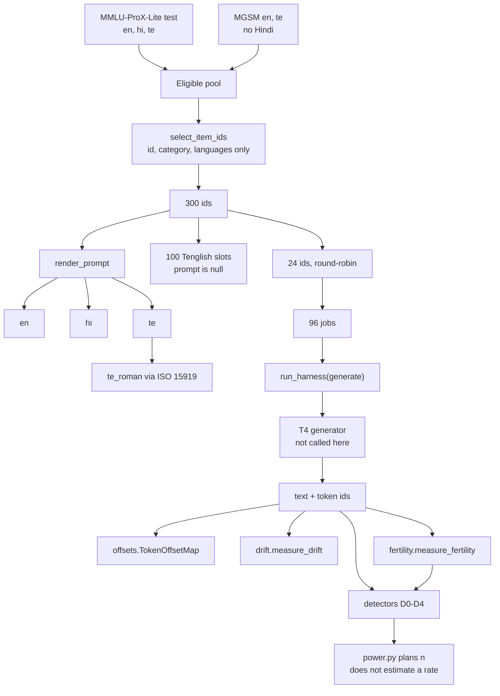

# Architecture

`loop_lingua` is a CPU package. It builds the prompt set, maps tokens onto
decoded text, and scores loops, fertility, and script drift. Generation on
a T4 is a later step that calls into `pilot.py`. It is not part of import.

## Modules

| Module | Role |
| --- | --- |
| `antidoom_rule.py` | Verbatim D0 sampler. Copy of paper-1, not an edit. |
| `offsets.py` | Byte-concatenation character map. |
| `bugreport.py` | Compares that map with `jspace.detection.TokenState`. |
| `graphemes.py` | Grapheme subset used by D2 and fertility. |
| `detectors.py` | D0–D4. |
| `transliterate.py` | Telugu to ISO 15919. |
| `prompts.py` | Sampling and rendering. No gold argument. |
| `build_dataset.py` | Writes `corpus/` from parquet and MGSM TSVs. |
| `fertility.py` | Tokens per character, given an encode function. |
| `drift.py` | Script share of a generation. |
| `power.py` | Two-proportion sample size and power. |
| `pilot.py` | 96-job harness and go/no-go arithmetic. |
| `pilot_t4.py` | CLI. Dry-run by default. |
| `licenses.py` | Upstream terms as read on 2026-10-30. |
| `corpus/` | Committed prompts, gold sidecar, MGSM supplement, bug counts. |

## Data flow for one future generation

1. Take a row from `corpus/pilot_96.jsonl` or `prompts_matched.jsonl`.
2. Generate token ids on the T4. Do not decode piece by piece.
3. `tokenizer.decode` the full id list for the string the detectors see.
4. `map_token_ids` if a character index must become a token index.
5. `detect` for D0–D4. D3 uses the id list. D4 uses characters-per-token from `measure_fertility` on the prompt language, not on the English score.
6. `measure_drift` on the generation, with the prompt language as `expected`.

Gold in `corpus/gold.jsonl` is unused until someone scores accuracy. It is not an input to step 1's selection.
